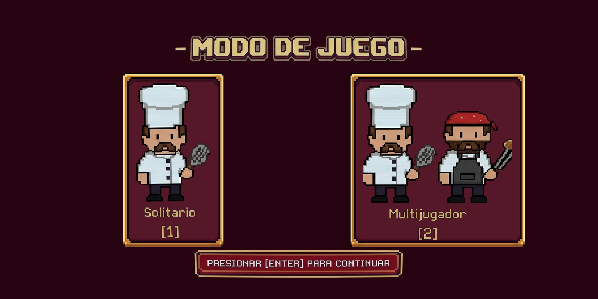
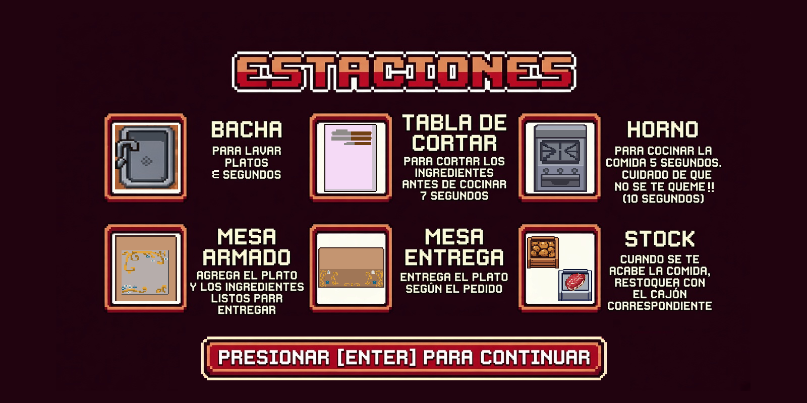

# Let Him Cook

🎮 **Jugar online:** https://troyanowollok.github.io/let-him-cook-WollokGame/

En un bodegón de barrio, después de un partido, una multitud de hinchas hambrientos espera su comida. Te dejaron al mando de la cocina, y la cosa es simple: cocinar, armar los platos y entregar cada pedido tal cual se pide, antes de que el cliente se canse de esperar.

Si dejás que se quemen los platos o se vencen 5 pedidos, ¡Estás fuera de la cocina!

## Equipo Troyano

**Integrantes**

- Cuello Gómez, María Agostina
- Goicoechea, Valentina
- Ocantos, Ulises

## Portada del juego

## 📜 Instrucciones

### 🔸 Objetivo principal

Llegar al puntaje de cada nivel entregando los pedidos que van apareciendo, sin quedarte sin vidas. Si pasás los 3 niveles, ganás.

### 🔸 Modos de juego

Se puede jugar solo o de a dos en la misma computadora. Al empezar se elige con `1` (solitario) o `2` (multijugador), después cada jugador elige su personaje con `1` o `2`, y con `ENTER` se avanza por las pantallas.

### 🔸 Controles

- **Jugador 1:** moverse con `W` `A` `S` `D`, agarrar y soltar con `E`, usar estaciones con `Q`.
- **Jugador 2:** moverse con las flechas, agarrar y soltar con `M`, usar estaciones con `K`.

Siempre se interactúa con lo que se tiene enfrente, según hacia dónde mire el personaje.

### 🔸 Estaciones

- **Cajones:** reponen huevo, bife, papa y pollo cuando se acaba el stock.
- **Tabla de cortar:** corta las papas antes de cocinarlas.
- **Horno (hay dos):** cocina la comida. Si la dejás de más, se quema.
- **Mesa del fernet:** llena los vasos.
- **Mesada de armado:** se apoya un plato limpio y se le suman los ingredientes cocinados.
- **Mesada de entrega:** entrega el plato según el pedido.
- **Bacha:** lava los platos sucios.
- **Basura:** para tirar lo que se quemó o no sirve.
  

### 🔸 Pedidos

Hay tres recetas:

- **Ojo de bife con huevo:** bife cocinado y huevo cocinado.
- **Pollo con papas:** pollo cocinado y papas cortadas y cocinadas.
- **Fernet con coca:** un vaso lleno, que se entrega solo, sin plato.

Cada 20 segundos llega un pedido nuevo. A los 20 segundos sin entregar pasa a "en espera", a los 30 a "urgente", y a los 40 se pierde. Si hay varios pedidos iguales, se entrega primero el más urgente.

### 🔸 Puntaje y vidas

- **Entregar un pedido:** 200 puntos, más 50 de bonus si el pedido era nuevo o 25 si estaba en espera.
- **Entregar un plato con un ingrediente quemado:** se restan 250.
- **Entregar algo que no coincide con ningún pedido:** se restan 100.
- **Dejar vencer un pedido:** se restan 100 y se pierde una vida.

Se empieza con 5 vidas, que se ven como corazones en pantalla. El puntaje nunca baja de 0.

### 🔸 Niveles

- **Nivel 1:** OBJETIVO: 750 puntos. Se piden ojo de bife con huevo y fernet.
- **Nivel 2:** OBJETIVO: 850 puntos. Se suma el pollo con papas.
- **Nivel 3:** OBJETIVO: 900 puntos. Están todas las recetas y la cocina cambia de distribución.

## Otros

- Facultad Regional Buenos Aires, Universidad Tecnológica Nacional (UTN FRBA) - Paradigmas de Programación
- Versión de Wollok: 4.0.0
- Presentación del proyecto: [ver acá](https://frbautneduar-my.sharepoint.com/:p:/g/personal/mcuellogomez_frba_utn_edu_ar/IQCr4bzKR4pnRZuBHmBFmnn6AQPMbDA9EQpBdgZuM0jYEbg?e=xQu1L3)
- Para correrlo en local hace falta Node.js y el CLI de Wollok (`npm install -g wollok-ts-cli`). Desde la carpeta del proyecto: `wollok run -g source.programa.juego`
