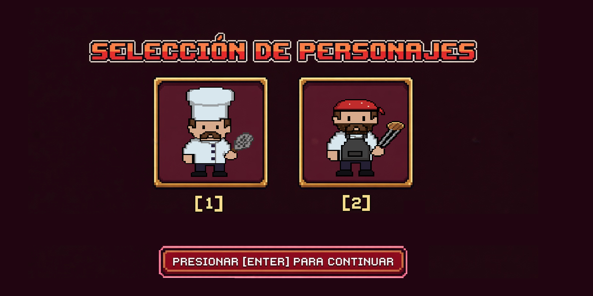
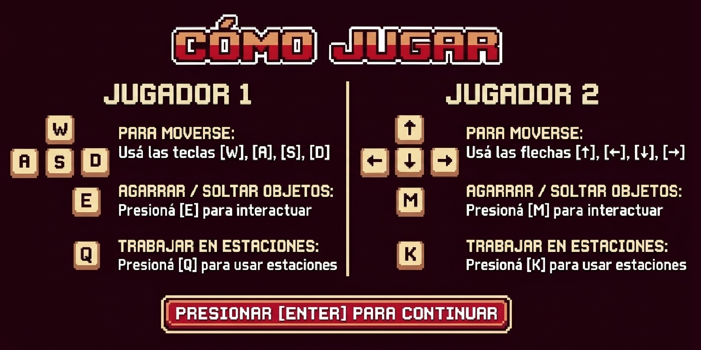
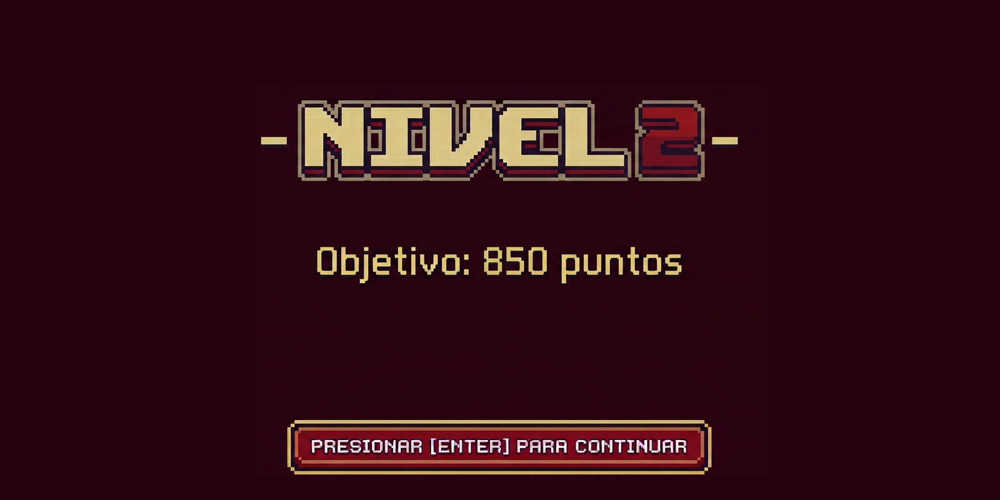
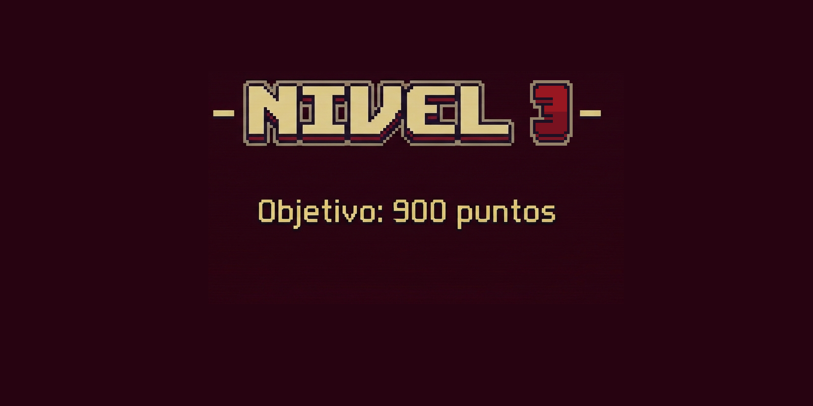

<div align="center">


### [Jugar online](https://valentinagoicoechea.github.io/let-him-cook-WollokGame/)

</div>

---

## La historia

<div align="center">

</div>

Te dejaron a cargo de un bodegón de barrio para darle de comer a una multitud de hinchas hambrientos después de un partido. Tenés que juntar puntos para pasar de nivel, administrar tu stock, no dejar que se quemen los platos y entregar cada pedido tal cual se pide. Si perdés 5 pedidos, quedás afuera de la cocina.

## Cómo se juega

Se puede jugar solo o de a dos en la misma computadora. Al empezar se elige el modo con `1` (solitario) o `2` (multijugador), y después cada jugador elige su personaje. Con `ENTER` se avanza por las pantallas.

<div align="center">


</div>

### Controles

Jugador 1: se mueve con `W` `A` `S` `D`, agarra y suelta con `E`, y usa las estaciones con `Q`.

Jugador 2: se mueve con las flechas, agarra y suelta con `M`, y usa las estaciones con `K`.

Siempre interactuás con lo que tenés enfrente, según hacia dónde estés mirando.

<div align="center">


</div>

### Las estaciones

<div align="center">

</div>

Hay cajones de ingredientes (huevo, bife, papa y pollo), una tabla de cortar, dos hornos, una mesa de fernet, una mesada de armado, una mesada de entrega, una bacha para lavar los platos y un tacho de basura. Los cajones se reponen cuando se vacían.

### Los pedidos

Hay tres recetas:

- **Ojo de bife con huevo:** bife cocinado y huevo cocinado, armados en un plato.
- **Pollo con papas:** pollo cocinado y papas cortadas y cocinadas, armados en un plato.
- **Fernet con coca:** un vaso lleno, que se entrega solo.

Los pedidos aparecen a la derecha. Cada 20 segundos llega uno nuevo y cada uno tiene 40 segundos de paciencia: a los 20 s pasa a "en espera", a los 30 s a "urgente", y a los 40 s se pierde. Si hay varios iguales, se entrega primero el más urgente.

### Cocinando

Lo comestible se cocina en el horno, pero las papas primero pasan por la tabla de cortar. Si te olvidás la comida en el horno, aparece un cartel de precaución y después se quema. Un ingrediente quemado hay que tirarlo a la basura.

Para armar un plato dejás un plato limpio en la mesada de armado, le apoyás los ingredientes cocinados, lo levantás y lo llevás a la mesada de entrega. Después el plato vuelve sucio y hay que lavarlo en la bacha.

## Puntaje y vidas

<div align="center">

</div>

- Entregar un pedido da 200 puntos, más un bonus por rapidez: 50 si el pedido es nuevo y 25 si está en espera.
- Entregar un plato con un ingrediente quemado resta 250.
- Entregar algo que no coincide con ningún pedido resta 100.
- Dejar vencer un pedido resta 100 y una vida.

Tenés 5 vidas, que se ven como corazones en pantalla. El puntaje nunca baja de 0.

## Niveles

<div align="center">



</div>

El nivel 1 pide 750 puntos con ojo de bife y fernet. El nivel 2 pide 850 y suma el pollo con papas. El nivel 3 pide 900 con todas las recetas y la cocina cambia de distribución. Si pasás el nivel 3, ganás.

## Información técnica

Hecho en Wollok Game (versión 4.0.0), con programación orientada a objetos y polimorfismo. Tiene tests en `source/tests.wtest`. El sitio web se publica solo con GitHub Actions y GitHub Pages en cada push a `main`.

Para correrlo en tu máquina necesitás Node.js y el CLI de Wollok:

```
npm install -g wollok-ts-cli
git clone https://github.com/ValentinaGoicoechea/let-him-cook-WollokGame.git
cd let-him-cook-WollokGame
wollok run -g source.programa.juego
```

Presentación del proyecto: [ver acá](https://frbautneduar-my.sharepoint.com/:p:/g/personal/mcuellogomez_frba_utn_edu_ar/IQCr4bzKR4pnRZuBHmBFmnn6AQPMbDA9EQpBdgZuM0jYEbg?e=xQu1L3)

## Equipo Troyano

- María Agostina Cuello Gómez
- Valentina Goicoechea
- Ulises Ocantos

Universidad Tecnológica Nacional, Facultad Regional Buenos Aires (UTN FRBA). Paradigmas de Programación, 2026.