<div align="center">

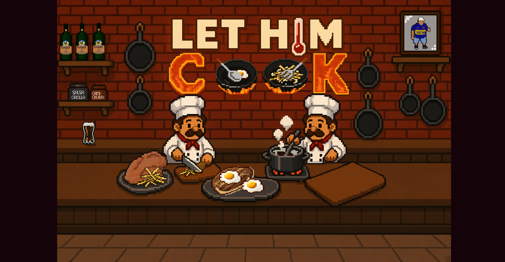

# 🍳 LET HIM COOK 🔥

### *¡Estás al mando, novato!*
**Un bodegón de barrio, una multitud de hinchas hambrientos y vos solo (o con un amigo) contra el reloj.**


## [▶️ ¡JUGAR AHORA!](https://valentinagoicoechea.github.io/let-him-cook-WollokGame/)

[📊 Presentación del proyecto](https://frbautneduar-my.sharepoint.com/:p:/g/personal/mcuellogomez_frba_utn_edu_ar/IQCr4bzKR4pnRZuBHmBFmnn6AQPMbDA9EQpBdgZuM0jYEbg?e=xQu1L3)

</div>

---

## 📑 Índice

- [🍳 LET HIM COOK 🔥](#-let-him-cook-)
    - [*¡Estás al mando, novato!*](#estás-al-mando-novato)
  - [▶️ ¡JUGAR AHORA!](#️-jugar-ahora)
  - [📑 Índice](#-índice)
  - [📖 La historia](#-la-historia)
  - [🎮 Modos de juego y personajes](#-modos-de-juego-y-personajes)
  - [🕹️ Cómo se juega](#️-cómo-se-juega)
    - [Un jugador](#un-jugador)
    - [Dos jugadores (¡cooperativo en la misma compu!)](#dos-jugadores-cooperativo-en-la-misma-compu)
  - [🔥 Las estaciones de la cocina](#-las-estaciones-de-la-cocina)
  - [📋 Recetas y pedidos](#-recetas-y-pedidos)
    - [⏳ La paciencia del cliente](#-la-paciencia-del-cliente)
  - [👨‍🍳 Paso a paso para entregar un plato](#-paso-a-paso-para-entregar-un-plato)
  - [🏆 Puntaje y vidas](#-puntaje-y-vidas)
  - [📈 Niveles](#-niveles)
  - [🧠 Consejos de chef](#-consejos-de-chef)
  - [🛠️ Información técnica](#️-información-técnica)
    - [📂 Estructura del repositorio](#-estructura-del-repositorio)
    - [💻 Correrlo en tu máquina](#-correrlo-en-tu-máquina)
  - [👥 Equipo](#-equipo)
    - [🔥 Equipo **Troyano** 🔥](#-equipo-troyano-)
    - [¡Ahora cocinen, que los hinchas esperan! 🥩🍟🥃](#ahora-cocinen-que-los-hinchas-esperan-)

---

## 📖 La historia

<div align="center">
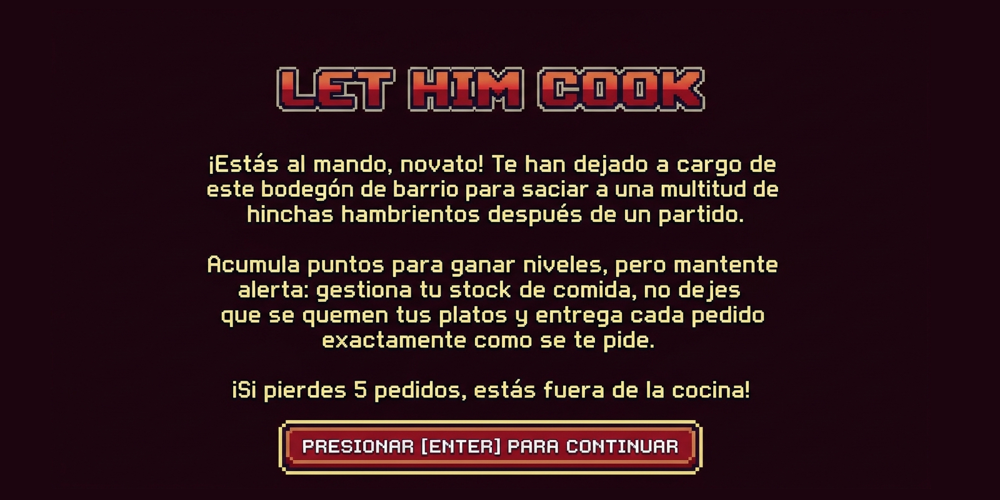
</div>

> Te dejaron a cargo de un bodegón de barrio para saciar a una multitud de hinchas hambrientos después de un partido. Acumulá puntos para ganar niveles, pero mantenete alerta: gestioná tu stock de comida, no dejes que se quemen tus platos y entregá cada pedido exactamente como se te pide.
>
> **¡Si perdés 5 pedidos, estás fuera de la cocina!**

---

## 🎮 Modos de juego y personajes

Al empezar elegís cómo jugar: **solitario** con `1` o **multijugador** con `2`, y confirmás con `ENTER`.

<div align="center">

| Solitario `[1]` | Multijugador `[2]` |
|:---:|:---:|
| 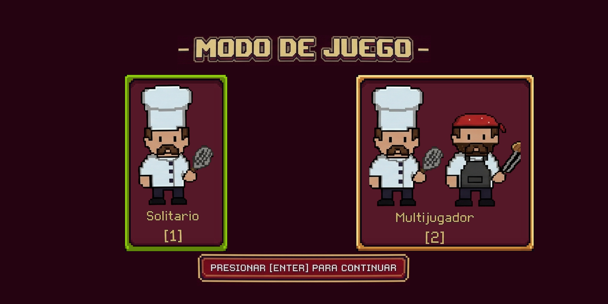 | 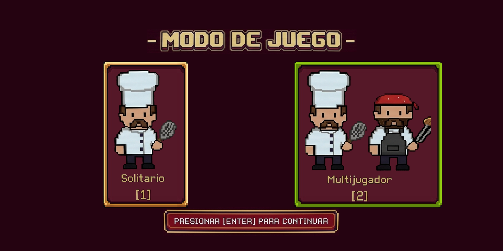 |

</div>

Después cada jugador elige su personaje con las teclas `1` o `2`. En multijugador elige primero el jugador 1 y después el jugador 2.

<div align="center">

| Jugador 1 | Jugador 2 |
|:---:|:---:|
| 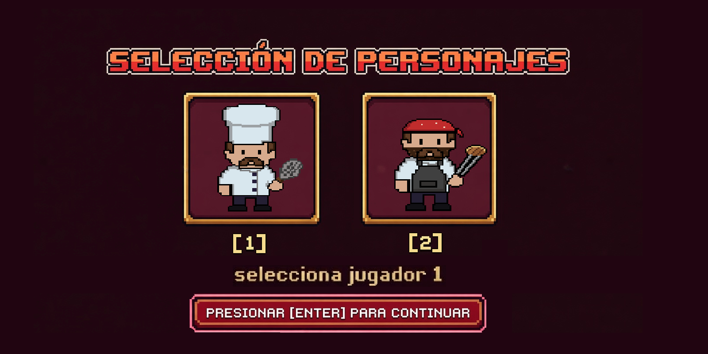 | 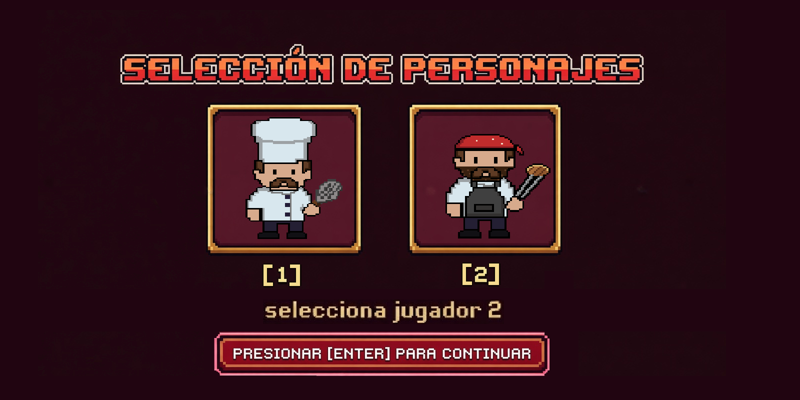 |

</div>

---

## 🕹️ Cómo se juega

### Un jugador
<div align="center">
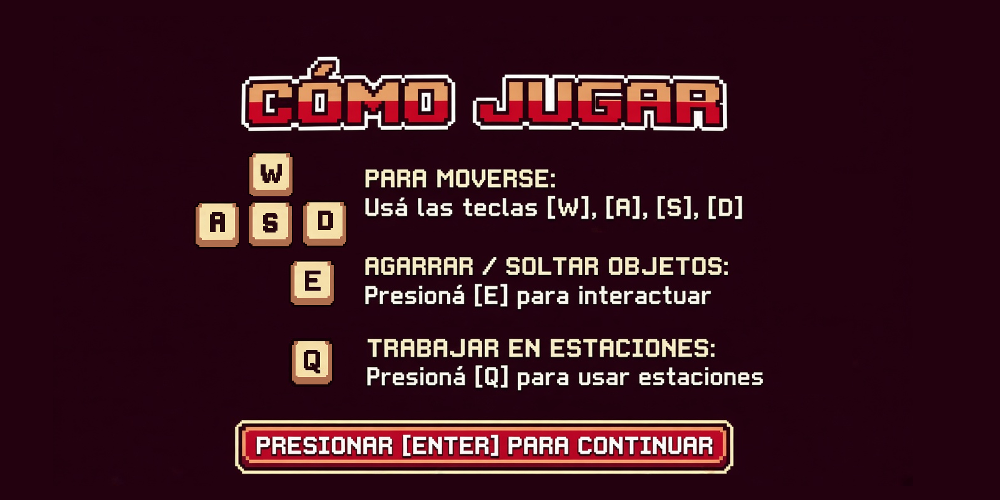
</div>

### Dos jugadores (¡cooperativo en la misma compu!)
<div align="center">

</div>

| Acción | 🧑‍🍳 Jugador 1 | 🧔 Jugador 2 |
|---|:---:|:---:|
| **Moverse** | `W` `A` `S` `D` | `⬆️` `⬅️` `⬇️` `➡️` |
| **Agarrar / soltar** | `E` | `M` |
| **Usar una estación** | `Q` | `K` |

> 💡 Siempre interactuás con lo que tenés **enfrente**, según hacia dónde estés mirando. Con `ENTER` avanzás por las pantallas y con `Z` salís del juego en la pantalla final.

---

## 🔥 Las estaciones de la cocina

<div align="center">

</div>

| Estación | Para qué sirve |
|---|---|
| 🧼 **Bacha** | Lava los platos sucios para dejarlos limpios otra vez |
| 🔪 **Tabla de cortar** | Corta los ingredientes antes de cocinar (las papas) |
| 🍳 **Horno** (hay dos) | Cocina la comida. ¡Cuidado, si te olvidás, se **quema**! |
| 🍽️ **Mesa de armado** | Ahí apoyás el plato y le sumás los ingredientes listos para entregar |
| 🛎️ **Mesa de entrega** | Entrega el plato según el pedido |
| 📦 **Stock (cajones)** | Cuando se acaba la comida, reponé con el cajón correspondiente |
| 🥃 **Mesa del fernet** | Llena los vasos de fernet |
| 🗑️ **Basura** | Para tirar lo que ya no sirve (quemado o equivocado) |

---

## 📋 Recetas y pedidos

Los pedidos aparecen a la derecha de la pantalla, y la imagen cambia a medida que el cliente se impacienta.

<div align="center">

| 🥩 Ojo de bife con huevo | 🍗 Pollo con papas | 🥃 Fernet con coca |
|:---:|:---:|:---:|
| 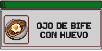 | 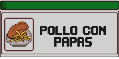 | 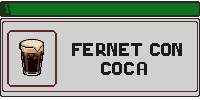 |
| Bife **cocinado** + huevo **cocinado** | Pechuga **cocinada** + papa **cortada y cocinada** | Vaso **lleno** (se entrega solo, sin plato) |

</div>

### ⏳ La paciencia del cliente

| Tiempo | Estado del pedido |
|---|---|
| 0 s | 🟢 **Nuevo** |
| 20 s | 🟡 **En espera** |
| 30 s | 🔴 **Urgente** (se entrega primero) |
| 40 s | ❌ **Perdido** (−1 vida) |

Cada **20 segundos** llega un pedido nuevo. Si hay varios pedidos iguales, el juego entrega el **más urgente**.

---

## 👨‍🍳 Paso a paso para entregar un plato

1. 📦 **Conseguí ingredientes.** Parate frente a un cajón con las manos vacías y apretá *usar estación* para reponer el stock (5 unidades). Solo se repone cuando el cajón está vacío.
2. 🔪 **Prepará.** Las papas pasan primero por la **tabla de cortar**. El bife, el huevo y el pollo van directo al **horno**.
3. ⚠️ **Mirá el horno.** Cuando la comida está cocinada, tenés poco tiempo antes de que aparezca el **cartel de precaución** y se **queme**. Sacala a tiempo.
4. 🍽️ **Armá el plato.** Dejá un plato limpio en la **mesa de armado** y apoyá encima los ingredientes cocinados. Después levantá el plato armado.
5. 🛎️ **Entregá** en la **mesa de entrega**.
6. 🧼 **Lavá.** El plato vuelve sucio: llevalo a la **bacha** para reutilizarlo.
7. 🗑️ **Tirá** a la basura lo que se quemó o no sirve.

---

## 🏆 Puntaje y vidas

<div align="center">

</div>

| Evento | Puntos |
|---|:---:|
| ✅ Entregar un pedido | **+200** |
| ⚡ Bonus por entregar rápido (pedido nuevo) | **+50** |
| ⚡ Bonus por entregar rápido (pedido en espera) | **+25** |
| 🔥 Entregar un plato con un ingrediente **quemado** | **−250** |
| ❓ Entregar algo que no coincide con ningún pedido | **−100** |
| ⌛ Dejar vencer un pedido | **−100** y **−1 vida** |

Tenés **5 vidas** (los corazones en pantalla). Si las perdés todas, se termina la partida. El puntaje nunca baja de 0.

<div align="center">

| 🏅 Final feliz | 💀 Final triste |
|:---:|:---:|
| 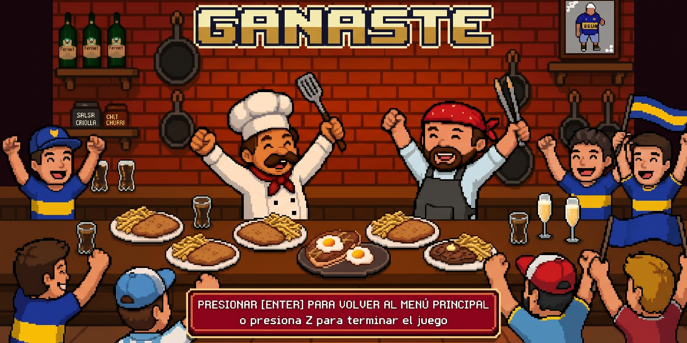 | 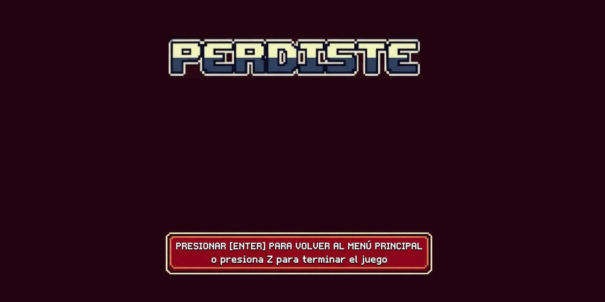 |

</div>

---

## 📈 Niveles

Llegá al puntaje objetivo de cada nivel para pasar al siguiente. Si completás el nivel 3, **ganás el juego**.

<div align="center">

| Nivel 1 | Nivel 2 | Nivel 3 |
|:---:|:---:|:---:|
| 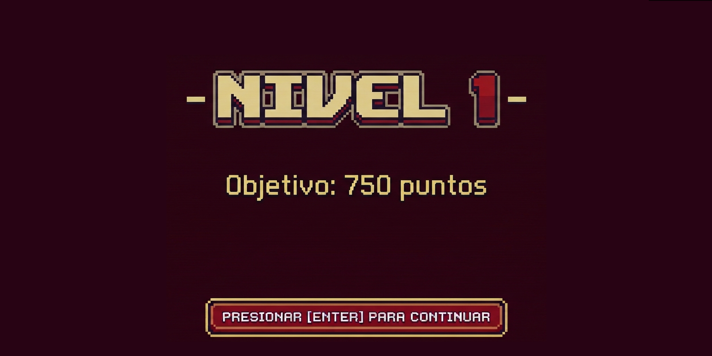 |  |  |
| **750 puntos** | **850 puntos** | **900 puntos** |
| Ojo de bife con huevo y fernet | Se suma el pollo con papas | Todas las recetas, ¡y la cocina cambia de lugar! |

</div>

<div align="center">
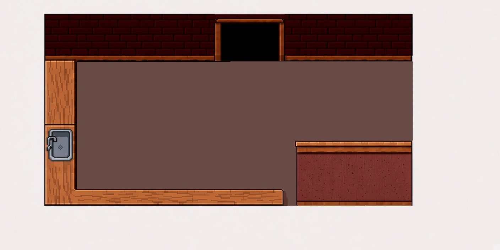
</div>

---

## 🧠 Consejos de chef

- 🍳 Poné la comida al horno y **andá armando el resto** mientras se cocina.
- 👀 Fijate qué pedido está **en rojo**: ese se entrega primero.
- 🧼 Lavá los platos apenas vuelvan sucios. Si no, te quedás sin vajilla.
- 📦 Reponé el stock **antes** de que se acabe del todo.
- 🤝 En multijugador, **repartanse los roles**: uno cocina, el otro arma y entrega.
- 🗑️ Un ingrediente quemado en el plato cuesta caro (−250). Mejor tirarlo y cocinar otro.

---

## 🛠️ Información técnica

- **Lenguaje y motor:** [Wollok](https://www.wollok.org) + Wollok Game (versión 4.0.0)
- **Paradigma:** orientado a objetos, con polimorfismo en estados de comida y vajilla, tareas de las estaciones, direcciones y niveles.
- **Tests:** tests automatizados con `wtest` en [`source/tests.wtest`](source/tests.wtest).
- **Sitio web:** se genera solo con GitHub Actions + GitHub Pages en cada push a `main`.

### 📂 Estructura del repositorio

```
.
├── assets/               # imágenes del juego
├── source/               # código fuente (.wlk, .wpgm, .wtest)
├── diagrama estatico/    # diagrama de clases
├── .github/workflows/    # deploy automático del sitio
├── package.json
└── README.md
```

### 💻 Correrlo en tu máquina

```bash
# 1. Instalar el CLI de Wollok (requiere Node.js)
npm install -g wollok-ts-cli

# 2. Clonar el repo
git clone https://github.com/ValentinaGoicoechea/let-him-cook-WollokGame.git
cd let-him-cook-WollokGame

# 3. Jugar
wollok run -g source.programa.juego

# 4. Correr los tests
wollok test
```

También podés abrir la carpeta en **VS Code** con la extensión de Wollok y ejecutar el programa `juego` desde `source/programa.wpgm`.

---

## 👥 Equipo

<div align="center">

### 🔥 Equipo **Troyano** 🔥

| Integrante | GitHub |
|---|---|
| María Agostina Cuello Gómez | [@a-cuello](https://github.com/a-cuello) |
| Valentina Goicoechea | [@ValentinaGoicoechea](https://github.com/ValentinaGoicoechea) |
| Ulises Ocantos | [@UlisesOcantos](https://github.com/UlisesOcantos) |
| Mariano Felipe Otero | [@OteroMarianoFelipe](https://github.com/OteroMarianoFelipe) |

🏫 **Universidad Tecnológica Nacional – Facultad Regional Buenos Aires (UTN FRBA)**
📚 Paradigmas de Programación – curso Viernes Turno Mañana · 2026

</div>

---

<div align="center">

### ¡Ahora cocinen, que los hinchas esperan! 🥩🍟🥃

*Hecho con ❤️, mucho fernet y poco sueño.*

</div>